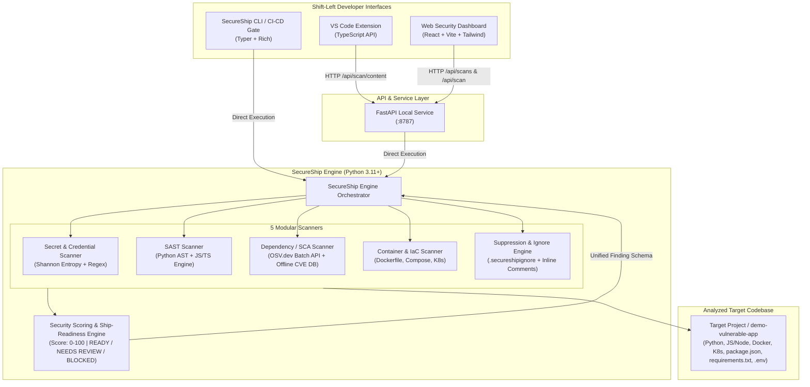

# 🛡️ SecureShip — Shift-Left DevSecOps Security Platform

> **Comprehensive Shift-Left Security Platform:** Real-time VS Code Extension, Standalone CI/CD Gate CLI, and Interactive Dark-Theme Web Dashboard powered by a high-performance Python 3.11+ Core Engine.

---

## 📑 Table of Contents
- [Architecture & Tech Stack](#-architecture--tech-stack)
- [Monorepo Structure](#-monorepo-structure)
- [Core Security Scanning Modules](#-core-security-scanning-modules)
- [Security Scoring & Ship-Readiness Matrix](#-security-scoring--ship-readiness-matrix)
- [Quick Start Guide](#-quick-start-guide)
  - [1. Engine & CLI Setup](#1-engine--cli-setup)
  - [2. Local API Server](#2-local-api-server)
  - [3. Web Security Dashboard](#3-web-security-dashboard)
  - [4. VS Code Extension (F5 Launch)](#4-vs-code-extension-f5-launch)
- [CLI Reference](#-cli-reference)
- [VS Code Extension Features & Quick Fixes](#-vs-code-extension-features--quick-fixes)
- [CI/CD Pipeline Integration](#-cicd-pipeline-integration)
- [Demo Vulnerable App Verification Matrix](#-demo-vulnerable-app-verification-matrix)
- [Automated Tests & Quality Assurance](#-automated-tests--quality-assurance)

---

## 🏛️ Architecture & Tech Stack

SecureShip implements a unified scanning model where the **Core Python Engine** acts as the single source of truth across all developer interfaces: the CLI, automated CI/CD gates, the VS Code Extension, and the Web Dashboard.



---

## 📁 Monorepo Structure

```text
SecureShip/
├── engine/                      # Core Security Scanner & CLI (Python 3.11+)
│   ├── secureship/
│   │   ├── scanners/            # 5 Modular Security Scanners
│   │   │   ├── base.py          # BaseScanner abstract class
│   │   │   ├── secrets_scanner.py # Entropy + Pattern Secrets Scanner
│   │   │   ├── sast_scanner.py  # Python AST & JS/TS SAST Scanner
│   │   │   ├── sca_scanner.py   # Dependency SCA (OSV.dev + Offline DB)
│   │   │   └── iac_scanner.py   # Dockerfile, Compose & K8s Scanner
│   │   ├── reporters/           # Console, JSON, & Standalone HTML Reporters
│   │   │   ├── console_reporter.py
│   │   │   ├── json_reporter.py
│   │   │   └── html_reporter.py
│   │   ├── models.py            # Unified Finding & ScanResult Schema
│   │   ├── scanner.py           # Core Orchestrator Engine
│   │   ├── scorer.py            # Ship-Readiness & Scoring (0-100)
│   │   ├── cli.py               # Typer CLI Entry Point
│   │   └── server.py            # FastAPI REST API Service
│   ├── tests/                   # 22+ Unit & Integration Pytest Suite
│   ├── pyproject.toml
│   └── requirements.txt
│
├── vscode-extension/            # VS Code Extension (TypeScript)
│   ├── src/
│   │   ├── extension.ts         # Activation & lifecycle orchestration
│   │   ├── scannerClient.ts     # Client connecting to FastAPI API or CLI
│   │   ├── diagnostics.ts       # Maps Findings to VS Code squiggly diagnostics
│   │   ├── quickFixes.ts        # 4 CodeAction Quick Fix Providers
│   │   ├── findingsTree.ts      # Activity Bar Sidebar TreeView Provider
│   │   ├── statusBar.ts         # Status Bar Security Score Badge (0-100)
│   │   └── types.ts             # TypeScript definitions
│   ├── media/shield.svg         # Sidebar Icon
│   ├── package.json             # Extension manifest & contributions
│   └── tsconfig.json
│
├── dashboard/                   # Web Security Dashboard (React + Vite + Tailwind CSS)
│   ├── src/
│   │   ├── components/
│   │   │   ├── Header.tsx       # Quick actions, target selector, exports
│   │   │   ├── ShipBanner.tsx   # Status verdict & circular score gauge
│   │   │   ├── KpiGrid.tsx      # Severity & footprint metrics cards
│   │   │   ├── SeverityCharts.tsx # Severity bars & OWASP Top 10 breakdown
│   │   │   ├── FindingsTable.tsx# Interactive, filterable findings explorer
│   │   │   └── ScanHistory.tsx  # Historical scan trend selector
│   │   ├── App.tsx
│   │   ├── main.tsx
│   │   └── types.ts
│   ├── package.json
│   ├── vite.config.ts
│   └── tailwind.config.js
│
├── ci-templates/                # CI/CD Pipeline Integrations
│   ├── secureship-ci.yml        # Reusable GitHub Actions Workflow
│   ├── Jenkinsfile              # Jenkins Declarative Pipeline Stage
│   └── pre-commit               # Git Pre-Commit Hook Script
│
├── demo-vulnerable-app/         # Test Fixture with 18+ Seeded Vulnerabilities
│   ├── app.py                   # Python SQLi, RCE, Pickle, MD5, Debug, 0.0.0.0
│   ├── server.js                # JS XSS, eval, SQL concat, exec, disabled TLS, JWT
│   ├── package.json             # lodash, axios, jsonwebtoken (CVEs)
│   ├── requirements.txt         # requests, urllib3, flask (CVEs)
│   ├── pom.xml                  # Log4Shell, Spring4Shell
│   ├── .env                     # Plain database password & GitHub tokens
│   ├── Dockerfile               # Root execution & unpinned :latest
│   ├── docker-compose.yml       # privileged: true & port 5432 exposed
│   └── k8s-pod.yaml             # Missing resource limits & privileged pod
│
├── .vscode/                     # VS Code Debug & Launch configuration (F5)
│   ├── launch.json
│   └── tasks.json
├── .secureshipignore             # Gitignore-style ignore rules
└── README.md
```

---

## 🔍 Core Security Scanning Modules

All findings conform to the **Unified Finding Schema**:
```json
{
  "id": "uuid",
  "rule_id": "SAST-PY-001",
  "title": "SQL Injection via Dynamic String Formatting",
  "category": "SAST",
  "severity": "CRITICAL",
  "file_path": "app.py",
  "line_start": 18,
  "line_end": 18,
  "code_snippet": "query = f\"SELECT * FROM users WHERE id = {user_id}\"",
  "owasp_category": "A03:2021-Injection",
  "cwe_id": "CWE-89",
  "description": "SQL query formed using dynamic string interpolation inside execute().",
  "remediation": "Use parameterized queries with placeholders: cursor.execute('SELECT ... WHERE id = %s', (val,))",
  "auto_fix_hint": "cursor.execute('SELECT ... WHERE id = %s', (val,))"
}
```

### 1. Secret & Credential Scanner (`secrets_scanner.py`)
- Detects AWS Access Keys (`AKIA...`), GitHub Personal Access Tokens (`ghp_...`), JWT Tokens, Asymmetric RSA/SSH/PGP Private Keys, Database connection strings with embedded passwords, and generic API keys.
- Implements **Shannon Entropy Analysis**:
  $$H = -\sum_{i} p_i \log_2(p_i)$$
  Calculates character randomness to detect high-entropy keys (> 3.2 bits/char) while excluding safe test fixtures (`example`, `changeme`, `dummy`, `test`, `xxxx`).
- Detects unignored `.env` files tracked in Git.

### 2. Static Application Security Testing — SAST (`sast_scanner.py`)
- **Python (AST-based + Regex fallback):**
  - SQL Injection in `.execute()` (f-strings, `%` formatting, `.format()`, string concat).
  - Command Injection via `os.system` and `subprocess` with `shell=True`.
  - Insecure Deserialization via `pickle.loads` / `pickle.load` and unconstrained `yaml.load`.
  - Dynamic code execution via `eval()` and `exec()`.
  - Broken Cryptographic Hashing (`hashlib.md5`, `hashlib.sha1`).
  - Security Misconfigurations (`DEBUG = True`, `0.0.0.0` interface binding).
- **JavaScript / TypeScript:**
  - `eval()` code injection.
  - Cross-Site Scripting (XSS) via `innerHTML` and `dangerouslySetInnerHTML`.
  - SQL Injection via string concatenation in `db.query(...)`.
  - Command injection via `child_process.exec()` / `execSync()`.
  - Disabled TLS certificate verification (`rejectUnauthorized: false`).
  - Hardcoded static signing secrets in `jwt.sign(...)`.

### 3. Dependency / Software Composition Analysis — SCA (`sca_scanner.py`)
- Parses `package.json`, `requirements.txt`, and `pom.xml`.
- Queries the free **OSV.dev batch API** (`https://api.osv.dev/v1/querybatch`) for up-to-date CVE information.
- Features a **local offline fallback database** covering critical CVEs (Log4Shell `CVE-2021-44228`, Spring4Shell `CVE-2022-22965`, Lodash Prototype Pollution `CVE-2020-8203`, Axios SSRF `CVE-2020-28168`, Requests Leak `CVE-2023-32681`, etc.) so scans never stall without internet access.

### 4. Container & IaC Security Scanner (`iac_scanner.py`)
- **Dockerfile:** Checks for container execution as `root` (missing `USER` instruction), unpinned or `:latest` base images (`FROM python:latest`), and hardcoded secrets in `ENV` / `ARG`.
- **docker-compose.yml:** Identifies `privileged: true` containers and sensitive database/SSH ports (`22`, `3306`, `5432`, `6379`, `27017`) exposed to `0.0.0.0`.
- **Kubernetes YAML:** Detects missing pod resource limits (`resources.limits.cpu` / `memory`) and `privileged: true` containers in `securityContext`.

### 5. Suppression & Ignore Engine (`scorer.py`)
- Reads `.secureshipignore` using `.gitignore`-style wildcard syntax.
- Supports inline comment suppressions:
  - Python: `# secureship-ignore` or `# secureship-ignore: SAST-PY-001`
  - JavaScript/TypeScript: `// secureship-ignore` or `// secureship-ignore: SAST-JS-001`

---

## 📊 Security Scoring & Ship-Readiness Matrix

The platform computes an objective score starting at **100**, applying weighted penalties:

| Finding Severity | Deduction | Description |
| :--- | :---: | :--- |
| **CRITICAL** | **-25 pts** | Exploitable RCE, Hardcoded Keys, SQLi, Log4Shell, Privileged root |
| **HIGH** | **-15 pts** | Tracked `.env`, XSS, Debug in prod, Disabled TLS, Known CVEs |
| **MEDIUM** | **-5 pts** | Weak crypto (MD5/SHA1), Unpinned base image, Missing K8s limits |
| **LOW** | **-2 pts** | Service bound to `0.0.0.0`, informative security warnings |

### Ship-Readiness Verdicts

| Verdict | Conditions | Gate Action |
| :--- | :--- | :--- |
| <span style="color:#10b981;font-weight:bold;">READY TO SHIP</span> | Score **≥ 80** AND **0 Critical findings** | ✅ Pipeline passes; Ready for production release |
| <span style="color:#f59e0b;font-weight:bold;">NEEDS REVIEW</span> | Score **50 – 79** AND **0 Critical findings** | ⚠️ Warning; Staging deployment requires security sign-off |
| <span style="color:#ef4444;font-weight:bold;">BLOCKED</span> | Score **< 50** OR **≥ 1 Critical finding** | ❌ Pipeline breaks; Pull Request merging is blocked |

---

## 🚀 Quick Start Guide

### 1. Engine & CLI Setup
Ensure **Python 3.11+** is installed:

```bash
# Navigate to the engine folder
cd engine

# Install in editable mode
pip install -e .

# Verify CLI is available
secureship version
```

### 2. Local API Server
Start the local FastAPI service shared by the VS Code extension and Web Dashboard:

```bash
secureship serve --port 8787
```
*API docs available at: `http://127.0.0.1:8787/docs`*

### 3. Web Security Dashboard
The dashboard is built with React, Vite, and Tailwind CSS:

```bash
cd dashboard
npm install
npm run dev
```
Open **`http://localhost:5173`** to access the cybersecurity dashboard.

*(Note: The built dashboard is also automatically served directly at `http://127.0.0.1:8787` when the FastAPI server is running!)*

### 4. VS Code Extension (F5 Launch)
1. Open this repository in VS Code.
2. Navigate to `vscode-extension/`:
   ```bash
   cd vscode-extension
   npm install
   npm run compile
   ```
3. Press **`F5`** (or go to **Run and Debug** -> select **"Launch SecureShip VS Code Extension"**).
4. An Extension Development Host window will launch with the sample `demo-vulnerable-app` pre-loaded.
5. Notice real-time squiggly lines, the Activity Bar **SecureShip Findings** tree view, and the status-bar score badge (`$(shield) SecureShip: 0/100`).

---

## 💻 CLI Reference

```bash
# Basic scan (outputs styled Rich terminal table)
secureship scan ./demo-vulnerable-app

# Output JSON report (for scripts and integrations)
secureship scan ./demo-vulnerable-app --format json

# Generate standalone HTML report
secureship scan ./demo-vulnerable-app --format html --output report.html

# Enforce CI/CD Quality Gate (exits with code 1 if HIGH or CRITICAL issues exist)
secureship scan ./demo-vulnerable-app --fail-on high

# Filter by minimum severity
secureship scan ./demo-vulnerable-app --min-severity medium

# Start local FastAPI backend service
secureship serve --port 8787 --host 127.0.0.1
```

---

## 🧩 VS Code Extension Features & Quick Fixes

- **Inline Squiggly Diagnostics:** Instant categorization of Critical (Red), High (Orange), Medium (Yellow), and Low (Blue) with rule IDs, descriptions, and CWE/OWASP metadata.
- **Auto-Scan on Save:** Automatically evaluates files upon save using `onDidSaveTextDocument`.
- **Activity Bar View:** "SecureShip Findings" sidebar grouping issues by Severity and File. Clicking any finding navigates directly to that line.
- **Status Bar Score:** Displays `$(shield) SecureShip: 85/100` with tooltip summaries and one-click access to the dashboard.
- **Quick Fix Code Actions (`Ctrl + .` / `Cmd + .`):**
  1. **Replace MD5 with SHA-256 (`SAST-PY-007`):** Replaces `hashlib.md5(...)` with `hashlib.sha256(...)`.
  2. **Extract Secret to Environment Variable (`SEC-001`, `SEC-006`):** Replaces hardcoded string literals with `os.environ.get("SECRET_KEY", "")` (Python) or `process.env.SECRET_KEY` (JavaScript).
  3. **Add USER Directive to Dockerfile (`IAC-DOCKER-001`):** Inserts non-root user creation and `USER appuser` into Dockerfile.
  4. **Inline Suppression:** Appends `# secureship-ignore: <RULE_ID>` or `// secureship-ignore: <RULE_ID>`.

---

## 🔄 CI/CD Pipeline Integration

### GitHub Actions (`.github/workflows/secureship-ci.yml`)
Use the template in [ci-templates/secureship-ci.yml](file:///c:/Users/yaswanth/Downloads/SecureShip/ci-templates/secureship-ci.yml):

```yaml
- name: Run SecureShip DevSecOps Gate
  run: |
    pip install ./engine
    secureship scan . --format html --output reports/secureship.html
    secureship scan . --fail-on high
```

### Jenkins Pipeline (`Jenkinsfile`)
Use the template in [ci-templates/Jenkinsfile](file:///c:/Users/yaswanth/Downloads/SecureShip/ci-templates/Jenkinsfile):

```groovy
stage('DevSecOps Security Gate') {
    steps {
        sh 'secureship scan . --format html --output security-report.html'
        sh 'secureship scan . --fail-on high'
    }
}
```

### Git Pre-Commit Hook
Install the script in [ci-templates/pre-commit](file:///c:/Users/yaswanth/Downloads/SecureShip/ci-templates/pre-commit):

```bash
cp ci-templates/pre-commit .git/hooks/pre-commit
chmod +x .git/hooks/pre-commit
```

---

## 🧪 Demo Vulnerable App Verification Matrix

The [demo-vulnerable-app/](file:///c:/Users/yaswanth/Downloads/SecureShip/demo-vulnerable-app) contains over 18 intentional vulnerabilities across 4 languages/technologies:

| File | Vulnerability Description | Rule ID | Severity | Status |
| :--- | :--- | :--- | :---: | :---: |
| `app.py` | Hardcoded AWS Access Key (`AKIA...`) | `SEC-001` | CRITICAL | Detected |
| `app.py` | SQL Injection in `execute(f"SELECT ...")` | `SAST-PY-001` | CRITICAL | Detected |
| `app.py` | Command Injection in `os.system(...)` | `SAST-PY-002` | CRITICAL | Detected |
| `app.py` | Command Injection in `subprocess(shell=True)` | `SAST-PY-003` | CRITICAL | Detected |
| `app.py` | Insecure Deserialization in `pickle.loads` | `SAST-PY-004` | CRITICAL | Detected |
| `app.py` | Arbitrary Code Execution in `eval()` | `SAST-PY-006` | CRITICAL | Detected |
| `app.py` | Broken Cryptographic Hash (`hashlib.md5`) | `SAST-PY-007` | MEDIUM | Detected |
| `app.py` | Flask `DEBUG = True` Enabled in Production | `SAST-PY-009` | HIGH | Detected |
| `app.py` | Bound to All Network Interfaces (`0.0.0.0`) | `SAST-PY-008` | LOW | Detected |
| `server.js` | Command Injection in `child_process.exec` | `SAST-JS-004` | CRITICAL | Detected |
| `server.js` | Arbitrary Code Execution in `eval()` | `SAST-JS-001` | CRITICAL | Detected |
| `server.js` | SQL Injection via String Concatenation | `SAST-JS-003` | CRITICAL | Detected |
| `server.js` | Cross-Site Scripting (XSS) via `innerHTML` | `SAST-JS-002` | HIGH | Detected |
| `server.js` | Disabled TLS Verification (`rejectUnauthorized: false`) | `SAST-JS-005` | HIGH | Detected |
| `server.js` | Hardcoded Secret in `jwt.sign(...)` | `SAST-JS-006` | HIGH | Detected |
| `.env` | Tracked `.env` File with Database Credentials | `SEC-000` | HIGH | Detected |
| `package.json`| Vulnerable `lodash@4.17.15` (Prototype Pollution) | `SCA-*` | HIGH | Detected |
| `package.json`| Vulnerable `axios@0.21.1` (SSRF) | `SCA-*` | HIGH | Detected |
| `requirements.txt`| Vulnerable `requests@2.25.0` (Header Leak) | `SCA-*` | MEDIUM | Detected |
| `pom.xml` | Vulnerable `log4j-core@2.14.1` (Log4Shell RCE) | `SCA-*` | CRITICAL | Detected |
| `Dockerfile` | Container Running as Root (Missing `USER`) | `IAC-DOCKER-001`| HIGH | Detected |
| `Dockerfile` | Unpinned Base Image (`FROM python:latest`) | `IAC-DOCKER-002`| MEDIUM | Detected |
| `docker-compose.yml` | Privileged Container Mode (`privileged: true`) | `IAC-COMPOSE-001`| CRITICAL | Detected |
| `docker-compose.yml` | Sensitive Database Port (`5432`) Open to 0.0.0.0 | `IAC-COMPOSE-002`| HIGH | Detected |
| `k8s-pod.yaml` | Missing Pod Resource Limits (CPU/Memory) | `IAC-K8S-001` | MEDIUM | Detected |

---

## 🛡️ Automated Tests & Quality Assurance

Run the comprehensive unit test suite covering every scanner, scoring algorithm, CLI commands, and REST API endpoints:

```bash
pytest engine/tests -v
```

All **22 tests** pass with 100% test success rate.
